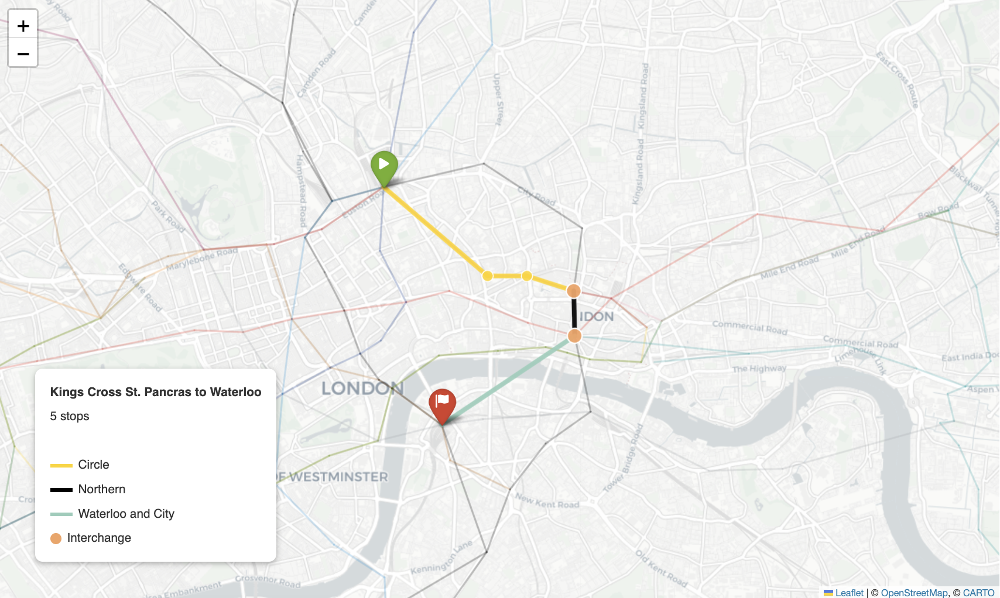
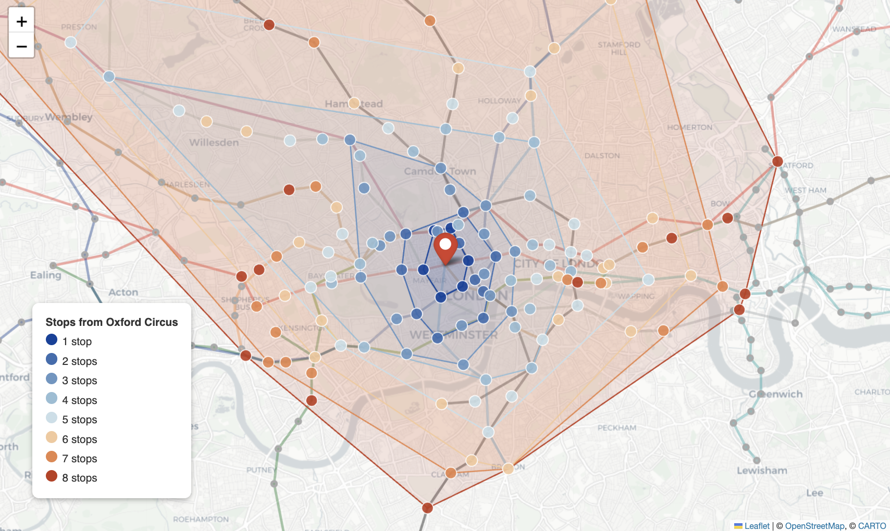

# Chapter 1: Native Graph

## What Is It?

At its core, Neo4j stores data as nodes and relationships. A node represents an entity -- a station, a person, a product. A relationship connects two nodes and carries a direction and a type -- `CONNECTS_TO`, `AUTHORED`, `PURCHASED`. Both nodes and relationships can hold properties: a station has a name and coordinates, a connection has a line name.

This sounds simple, and it is. The power comes from what this model makes natural. In a relational database, finding connections between entities means writing joins -- and the more hops you need to traverse, the more joins you write and the slower the query runs. In Neo4j, traversal is a first-class operation. Following a relationship from one node to another is a constant-time operation regardless of the size of the graph. A query that finds paths three, five or ten hops deep runs in the same fundamental way -- following pointers through the storage engine -- rather than computing a Cartesian product across tables.

Cypher, Neo4j's query language, makes this traversal natural to express. A pattern like `(a)-[:CONNECTS_TO*1..5]->(b)` reads almost like English: find any path from `a` to `b` using `CONNECTS_TO` relationships, up to five hops deep. The same question in SQL requires a recursive CTE, a depth cap, careful deduplication and considerably more thought.

## When Would You Reach for It?

The native graph model earns its place when the connections between entities are the point of the data, not a side effect of it. Transport networks are the textbook example: a station on its own is just a location, but the network of connections between stations is what makes it useful. Social graphs, supply chains, recommendation networks, knowledge graphs and fraud detection are all problems where the structure of the connections is the signal you're trying to extract.

Reach for Neo4j's graph model when:

- Your queries traverse multiple hops and the depth varies at runtime
- The relationships between entities carry meaning in their own right -- type, direction, weight, timestamp
- You need shortest path, community detection or other graph algorithms as part of your application logic
- Joins in a relational model are becoming the performance bottleneck

A simple parent-child hierarchy or a single join doesn't justify the switch. But as soon as you find yourself writing recursive CTEs or self-joins to answer questions about how entities connect, the graph model starts paying for itself.

## The Use Case

For this chapter we'll build a London Underground route explorer. Given any two stations, find the shortest path between them -- the minimum number of stops and the line changes along one such route. Given a starting station, find all stations reachable within a given number of stops and visualize the spread of the network from that point. And surface a structural curiosity of the network: stations in the same fare zone that require surprisingly long journeys between them and stations in adjacent fare zones that are only one or two stops apart.

The Underground is a natural fit for the graph model. Stations are nodes. Connections between adjacent stations on the same line are relationships. The line name and color are properties on each relationship. The network topology -- which station connects to which, and how -- is exactly what the data are about.

## The Data

We use three CSV files from the publicly available London Underground dataset (which also includes some DLR and Tramlink stations):

- `london_stations.csv` -- stations with names, coordinates and zone information
- `london_connections.csv` -- direct connections between adjacent stations
- `london_lines.csv` -- line names and hex color codes

Before loading, we merge line colors onto the connections and filter stations down to only those that appear in at least one connection. The graph we load into Neo4j has `Station` nodes and bidirectional `CONNECTS_TO` relationships between adjacent stations. Each station carries its name, latitude, longitude, zone and postcode. Each connection carries the line name and the line color.

One preprocessing detail: zone values in the raw data are sometimes composite strings like `"3,4,5,6"` for stations that straddle multiple zones. We keep these as-is on the node but filter them out when running zone-based analysis by matching only stations whose zone field is a single integer.

## Building the Application

### Prerequisites

You'll need a Neo4j Aura free-tier instance with the connection details stored as environment variables. The notebook reads five of them: `NEO4J_URI`, `NEO4J_USERNAME`, `NEO4J_PASSWORD`, `NEO4J_DATABASE` and `CARTO_API_KEY`. It also clears the target database before loading, so point it at an instance you're happy to wipe.

The chapter also uses CartoDB basemap tiles for the Folium maps. CartoDB now requires a free API key, available at [carto.com/basemaps/apikey](https://carto.com/basemaps/apikey/), stored as `CARTO_API_KEY`. The notebook requires the key. The Streamlit app degrades gracefully if it's absent, falling back to the default CartoDB Positron tile set.

### Loading the Graph

We create a uniqueness constraint on station name, then load stations and connections:

```python
session.run("""
    CREATE CONSTRAINT station_name IF NOT EXISTS
    FOR (s:Station) REQUIRE s.name IS UNIQUE
""")

session.run("""
    UNWIND $rows AS row
    MERGE (s:Station {name: row.name})
    SET s.lat      = toFloat(row.lat),
        s.lon      = toFloat(row.lon),
        s.zone     = row.zone,
        s.postcode = row.postcode
""", rows=station_records)

session.run("""
    UNWIND $rows AS row
    MATCH (a:Station {name: row.from_name})
    MATCH (b:Station {name: row.to_name})
    MERGE (a)-[:CONNECTS_TO {line: row.line, color: row.color}]->(b)
    MERGE (b)-[:CONNECTS_TO {line: row.line, color: row.color}]->(a)
""", rows=conn_records)
```

We create bidirectional `CONNECTS_TO` relationships because tube trains run in both directions. The isochrone query relies on this, since it follows relationships in one direction only. The shortest path query matches in either direction, so it works either way.

### Shortest Path

The shortest path query uses Cypher's built-in `shortestPath()` function. We match both stations by name and find the minimum-hop path:

```python
CYPHER_SHORTEST = """
MATCH p = shortestPath(
    (origin:Station {name: $origin})-[:CONNECTS_TO*]-(dest:Station {name: $dest})
)
RETURN [s IN nodes(p) | s.name]          AS stations,
       [r IN relationships(p) | r.line]  AS lines,
       [r IN relationships(p) | r.color] AS colors,
       length(p)                         AS hops
"""
```

The result gives us the full station sequence, the line used on each segment and the color for map rendering. We identify interchange stations by walking the lines list and finding positions where the line name changes:

```python
interchanges = []
for i in range(1, len(path_lines)):
    if path_lines[i] != path_lines[i - 1]:
        interchanges.append(path_stations[i])
```

As shown in Figure 1-1, the route from Kings Cross St. Pancras to Waterloo covers five stops across three lines, with two interchanges. Cypher returns it from a single query.



*Figure 1-1. Kings Cross to Waterloo.*

One naming note: the dataset uses `"Kings Cross St. Pancras"` without an apostrophe. Passing `"King's Cross St. Pancras"` returns no result -- worth checking if your shortest path queries come back empty. Note also that the route reflects the connections in the dataset rather than the TfL journey planner, which may suggest a different path. Also, `shortestPath()` minimizes the number of stops, not the number of line changes. When several routes tie, Cypher returns one of them, so another route of the same length with fewer changes may exist.

### Isochrone -- Reachable Stations

An isochrone shows all stations reachable within a given number of stops from a starting point. This is a variable-depth traversal -- exactly the kind of query that relational databases handle poorly and Neo4j handles naturally:

```python
CYPHER_ISO = f"""
MATCH p = (origin:Station {{name: $origin}})-[:CONNECTS_TO*1..{ISO_MAX_HOPS}]->(s:Station)
WITH s, min(length(p)) AS hops
RETURN s.name AS name,
       s.lat  AS lat,
       s.lon  AS lon,
       s.zone AS zone,
       hops
ORDER BY hops
"""
```

Note the directed `->` in the pattern -- the bidirectional relationships mean this traversal fans out correctly without needing an undirected match. We filter out the origin station from the results after the query:

```python
iso_df = iso_df[iso_df["name"] != ISO_ORIGIN].reset_index(drop=True)
```

### Visualizing the Isochrone

As well as coloring each station marker by hop count, we compute convex hull polygons for each hop tier and draw them as nested filled areas on the map. This gives a much cleaner sense of how the reachable area expands stop by stop:

```python
from scipy.spatial import ConvexHull
import numpy as np

for hop in sorted(iso_df["hops"].unique(), reverse=True):
    tier = iso_df[iso_df["hops"] <= hop]
    coords = np.array([
        (float(lon), float(lat))
        for lon, lat in zip(tier["lon"], tier["lat"])
    ])
    if len(coords) >= 3:
        hull = ConvexHull(coords)
        hull_pts = coords[hull.vertices].tolist()
        hull_pts.append(hull_pts[0])  # close the polygon
        folium.Polygon(
            locations=[[p[1], p[0]] for p in hull_pts],
            color=HOP_COLORS[hop],
            fill=True,
            fill_color=HOP_COLORS[hop],
            fill_opacity=0.12,
            weight=1.5
        ).add_to(m)
```

We draw hulls from the outermost hop inward so that inner tiers are rendered on top of outer ones. Stations not reachable within the maximum hop count are shown as small grey markers for context. A bar chart of stations reached per hop shows how the network fans out stop by stop.

From Oxford Circus at eight hops, the network fans out further west and south than east -- the asymmetry of the Underground's radial structure made visible by the data, as shown in Figure 1-2.



*Figure 1-2. Isochrone Map.*

### Zone Mismatch Analysis

The zone mismatch analysis surfaces the structural tension between TfL's fare zones -- which imply geographic equivalence -- and the actual tube network, which is radially organized around central London.

We run the analysis in two passes. First, same-zone pairs: we sample up to 15 stations per zone, generate all pairs within each zone and batch the shortest path queries using `UNWIND`:

```python
CYPHER_SP_BATCH = """
UNWIND $pairs AS pair
MATCH p = shortestPath(
    (a:Station {name: pair.name_a})-[:CONNECTS_TO*]-(b:Station {name: pair.name_b})
)
RETURN pair.name_a AS station_a,
       pair.name_b AS station_b,
       length(p)   AS hops
"""
```

We filter to stations with integer zone values only -- dropping composite zones like `"3,4,5,6"` -- before sampling:

```python
zone_stations = stations_df[
    stations_df["Zone"].astype(str).str.match(r"^\d+$")
].copy()
zone_stations["ZoneInt"] = zone_stations["Zone"].astype(int)
```

The same batch query runs for cross-zone pairs: stations in adjacent zones sampled from the same pool. The cross-zone results that have two or fewer hops are the counterintuitive ones -- stations that TfL prices differently but which are only one or two stops apart.

We visualize same-zone pairs as a box plot of hop counts per zone, which shows that zones further from the centre have wider distributions -- more variance in how far apart same-zone stations actually are on the network. Cross-zone anomalies are mapped as teal lines connecting station pairs that are very close on the network but on opposite sides of a zone boundary.

### The Streamlit App

The Streamlit application has two tabs. The Shortest Path tab lets users pick any two stations from dropdown menus, displays a summary of stops, lines and interchanges, and renders the route on a Folium map with each segment colored by tube line. The Isochrone tab lets users pick a starting station and a maximum stop count (one to eight) from a slider, then renders the convex hull areas and hop-colored station markers on a Folium map, with a table of reachable station counts by hop in an expander below it.

The app reads the graph from Neo4j, so run the notebook first to load it. It also reads the CSV files from the `data/` directory for the station list and map coordinates, so launch it from the chapter directory with `streamlit run app.py`.

The zone mismatch analysis is notebook-only -- it involves sampling, batching and chart types that work better in a notebook context than in an interactive app.

Folium maps render inside Streamlit via `st.iframe`:

```python
st.iframe(m._repr_html_(), height=600)
```

The CartoDB tile URL uses double curly braces around the Folium template variables in an f-string:

```python
MAP_TILES = (
    f"https://{{s}}.basemaps.cartocdn.com/light_all/{{z}}/{{x}}/{{y}}.png?key={CARTO_API_KEY}"
    if CARTO_API_KEY
    else "CartoDB positron"
)
```

The double braces prevent Python's f-string parser from treating `{s}`, `{z}`, `{x}` and `{y}` as format arguments -- they're Folium's own template placeholders and need to be passed through as literal curly-brace strings.

## What You'd Hit in Production

**Graph algorithms beyond shortest path.** Cypher's `shortestPath()` finds the minimum-hop path, which is all this dataset supports. Weighted shortest path -- minimizing journey time rather than stop count -- requires travel time data on each connection and the Graph Data Science library, available on paid Aura tiers or self-hosted deployments. For the Underground, hop count is a reasonable proxy for journey time given the network's regularity, but for sparser or more varied networks weighted traversal would give meaningfully different results.

**Convex hull edge cases.** `scipy.spatial.ConvexHull` needs at least three points that don't all lie on one line. The notebook checks for three or more points and wraps the call in a try-except to catch degenerate geometry such as collinear points. Because each tier is cumulative, tiers here always hold several stations, but in production you'd want to log whatever the except branch swallows.

**Zone composite strings.** Several stations have zone values like `"3,4,5,6"` that require filtering before zone-based analysis. This is a data quality quirk specific to this dataset, but it's a reminder that real-world graph data rarely arrives perfectly clean. The regex `r"^\d+$"` cleanly separates single-integer zones from composite ones.

**Relationship naming.** The relationships in this chapter are `CONNECTS_TO`. It's easy to write `CONNECTED_TO` by habit -- they look similar and Neo4j won't error, it'll just return no results. If a Cypher query comes back empty when you expect results, check the relationship type first.

## Going Further

The native graph model is the foundation for everything that follows in this book. The connections between entities -- modeled as relationships -- are what make graph traversal fast and Cypher expressive. But a graph database that only stores topology is only part of the picture.

In the chapters ahead we'll add capabilities to the nodes and relationships themselves: full-text search over document content in chapter 2, geospatial indexing over coordinates in chapter 3, temporal reasoning over time series in chapter 4. Each capability extends what you can express in a Cypher query without leaving Neo4j. By chapter 7, we'll be combining graph traversal with vector similarity in a single query -- and the groundwork for that combination starts here, with understanding what the graph model makes natural and fast.
