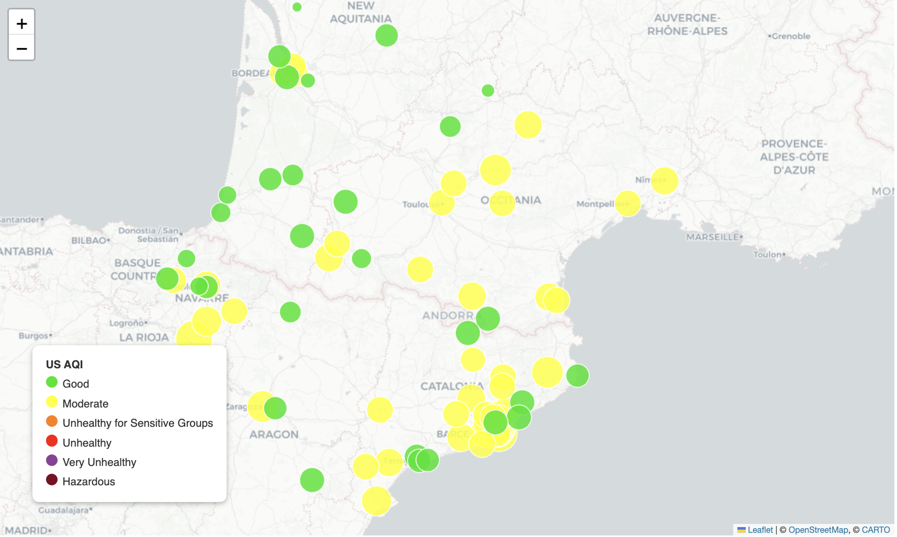
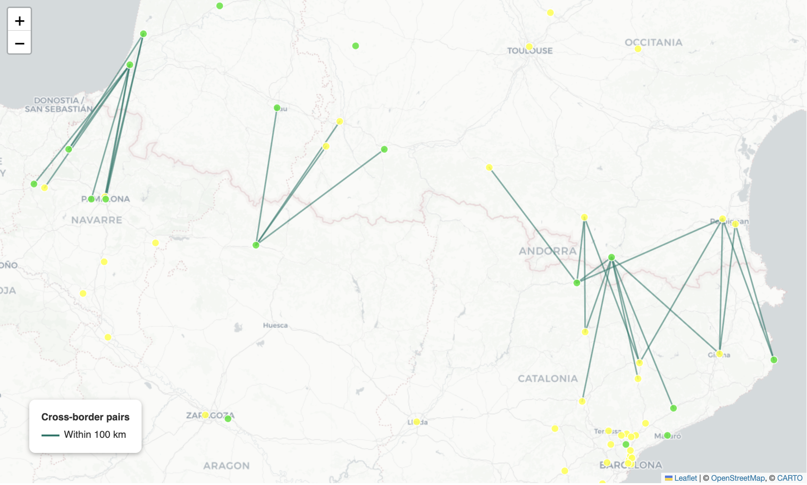

# Chapter 3: Geospatial

## What Is It?

Neo4j supports native geospatial data through its `point` type -- a first-class property that stores 2D or 3D coordinates and enables spatial queries directly in Cypher. Rather than computing distances in application code, you can ask the database: which cities are within 150 km of Barcelona? Which cross-border pairs are geographically closest? The answer comes back as nodes you can immediately traverse.

The `point` type integrates with Neo4j's indexing infrastructure. A point index on a property can speed up spatial range queries and proximity lookups against a fixed point. You create it the same way as any other index. The queries in this chapter compare two stored points after aggregating readings, so they likely don't benefit from it, which is fine at this scale.

What makes this distinctive is the combination with graph structure. Geographic proximity is one kind of relationship between places. But places also have relationships to each other through the network -- neighboring cities, shared air corridors, administrative boundaries. Neo4j lets you query both with the same language: find cities within a radius using `point.distance()` and traverse the pre-computed `NEIGHBORS` graph to explore cross-border connectivity. The neighbor network is built from spatial distance at ingest time, then queried like any other graph.

## When Would You Reach for It?

Geospatial queries in Neo4j earn their place when location is one dimension of a richer graph. Pure geospatial problems -- mapping, routing, satellite imagery -- belong in dedicated GIS platforms. But when your entities have both a location and a network of relationships and you need to query across both, Neo4j handles this naturally.

Reach for Neo4j's geospatial capability when:

- Your entities have coordinates and also have meaningful relationships to each other
- You want to combine proximity queries with graph traversal in a single operation
- You're already using Neo4j and adding spatial queries doesn't justify a second system
- You're asking questions like "find the nearest X, then follow the graph from there"

Environmental monitoring is a strong use case: monitoring stations have locations, but air quality also spreads through corridors, follows wind patterns and crosses administrative borders. Both the spatial and the network dimension matter.

## The Use Case

For this chapter we'll explore air quality data along the Pyrenees corridor -- the mountain range that forms the border between France and Spain. We fetch real air quality and weather readings from the IQAir API for cities in two French regions (Occitanie and Nouvelle-Aquitaine) and three Spanish regions (Aragon, Catalonia and Navarre), load them into Neo4j with coordinates stored as native point types and then query across both dimensions: which cities are nearest to a reference city, which French-Spanish pairs are geographically close, which neighboring pairs have the biggest pollution difference and which city is most central to the corridor network.

## The Data

Air quality readings come from the IQAir API. A free API key is sufficient -- the free tier allows five requests per minute and the ingest notebook spaces calls 12 seconds apart to stay within that limit. The free tier also caps calls at 500 per day, and one ingest run uses fewer than 100.

Each city produces a `Reading` node with: `aqi_us` (the US AQI value), `aqi_cn` (the Chinese AQI value), `aqi_category` (Good through Hazardous), `main_pollutant`, `temperature`, `pressure`, `humidity`, `wind_speed`, `wind_direction` and `timestamp`.

The graph model is:

```
(:City {name, country, state, location})
  -[:HAS_READING]->
(:Reading {timestamp, aqi_us, aqi_cn, aqi_category, main_pollutant,
           temperature, pressure, humidity, wind_speed, wind_direction})
```

`NEIGHBORS` relationships connect cities within 200 km of each other, computed at ingest time using `point.distance()` in Cypher.

IQAir's city list includes some districts of larger cities, such as several Barcelona neighborhoods. We treat them as cities.

Figure 3-1 shows the corridor at a glance -- green markers indicate Good air quality, yellow Moderate, with marker size reflecting AQI value.



*Figure 3-1. Air Quality across the Pyrenees Corridor.*

## Building the Application

### Prerequisites

You'll need a Neo4j Aura free-tier instance with the connection details stored as environment variables. The notebooks and app read `NEO4J_URI`, `NEO4J_USERNAME`, `NEO4J_PASSWORD` and `NEO4J_DATABASE`. The geospatial notebook and app also use `CARTO_API_KEY`, and the ingest notebook uses `IQAIR_API_KEY`.

The chapter also uses CartoDB basemap tiles for the Folium maps. CartoDB now requires a free API key, available at [carto.com/basemaps/apikey](https://carto.com/basemaps/apikey/), stored as `CARTO_API_KEY`. The notebook requires the key. The Streamlit app degrades gracefully if it's absent, falling back to the default CartoDB Positron tile set.

**Loading the data.** The repo includes a pre-populated Aura backup file (`03_aqi_geospatial.backup`). The fastest way to get started is to import it into your Aura instance directly: open the Aura console, select your instance, go to **...** > **Restore from File** and upload the backup file. Restoring overwrites everything currently in the instance, so use one you're happy to replace. Once the import completes, the database is ready and you can skip straight to `03_aqi_geospatial.ipynb`.

If you'd prefer to fetch fresh data yourself -- or want to extend the city list -- run `03_aqi_ingest.ipynb` instead. You'll need an additional IQAir API key stored as `IQAIR_API_KEY` and the ingest takes ~20 minutes due to the IQAir free-tier rate limit of five requests per minute.

### Storing Coordinates as Points

The uniqueness constraint on `City` uses a composite key -- name and country together -- because the same city name can appear in both France and Spain:

```python
session.run("""
    CREATE CONSTRAINT city_unique IF NOT EXISTS
    FOR (c:City) REQUIRE (c.name, c.country) IS UNIQUE
""")

session.run("""
    CREATE POINT INDEX city_location IF NOT EXISTS
    FOR (c:City) ON (c.location)
""")
```

Cities are loaded with `MERGE` so the notebook is safe to re-run as new readings accumulate. Coordinates are stored as a native Neo4j `point`:

```python
session.run("""
    MERGE (c:City {name: $city, country: $country})
    SET c.state    = $state,
        c.location = point({latitude: $lat, longitude: $lon})
""", **record)
```

Each API call produces a new `Reading` node timestamped at the time of the fetch. Readings accumulate over time -- running the ingest notebook daily builds a time series of air quality readings per city.

### Computing NEIGHBORS in Cypher

The `NEIGHBORS` relationship is computed entirely in Cypher using `point.distance()`. No Python distance calculation needed:

```python
session.run("""
    MATCH (a:City), (b:City)
    WHERE elementId(a) < elementId(b)
      AND point.distance(a.location, b.location) / 1000 <= $max_km
    WITH a, b,
         round(point.distance(a.location, b.location) / 1000, 1) AS distance_km
    MERGE (a)-[r:NEIGHBORS]-(b)
    SET r.distance_km = distance_km
    RETURN count(*) AS neighbors_created
""", max_km=NEIGHBOR_DISTANCE_KM)
```

`elementId(a) < elementId(b)` makes each pair appear once and stops a city from pairing with itself -- without it, the query does double the work and creates a zero-distance `NEIGHBORS` relationship from every city to itself. `MERGE` rather than `CREATE` means running the ingest notebook again won't create duplicate relationships.

### Query 1: Latest AQI per City

When reading point properties back in Cypher, we access latitude and longitude with dot notation on the point value:

```python
result = session.run("""
    MATCH (c:City)-[:HAS_READING]->(r:Reading)
    WITH c, r ORDER BY r.timestamp DESC
    WITH c, collect(r)[0] AS latest
    RETURN c.name                AS city,
           c.country             AS country,
           c.location.latitude   AS lat,
           c.location.longitude  AS lon,
           latest.aqi_us         AS aqi_us,
           latest.aqi_category   AS aqi_category,
           latest.main_pollutant AS main_pollutant,
           latest.temperature    AS temperature,
           latest.humidity       AS humidity,
           latest.wind_speed     AS wind_speed
""")
```

The `collect(r)[0]` pattern retrieves the most recent reading per city by sorting by timestamp descending first, then taking the first element of the collected list. This is a common Neo4j idiom for "latest record per group."

### Query 2: Cities Within Radius

The proximity query uses `point.distance()` in the `WHERE` clause. The function returns meters, so we divide by 1000 for kilometers:

```python
result = session.run("""
    MATCH (ref:City {name: $city, country: $country})
    MATCH (c:City)-[:HAS_READING]->(r:Reading)
    WITH ref, c, r ORDER BY r.timestamp DESC
    WITH ref, c, collect(r)[0] AS latest
    WHERE c <> ref
      AND point.distance(ref.location, c.location) / 1000 <= $radius_km
    RETURN c.name AS city,
           c.country AS country,
           round(point.distance(ref.location, c.location) / 1000, 1) AS distance_km,
           latest.aqi_us AS aqi_us,
           latest.aqi_category AS aqi_category
    ORDER BY distance_km
""", city=city, country=country, radius_km=radius_km)
```

### Query 3: Cross-Border Neighbors

This query traverses the pre-computed `NEIGHBORS` graph to find French-Spanish city pairs, then joins the latest reading for each:

```python
result = session.run("""
    MATCH (a:City)-[n:NEIGHBORS]-(b:City)
    WHERE a.country = 'France' AND b.country = 'Spain'
    MATCH (a)-[:HAS_READING]->(ra:Reading)
    MATCH (b)-[:HAS_READING]->(rb:Reading)
    WITH a, b, n, ra, rb ORDER BY ra.timestamp DESC, rb.timestamp DESC
    WITH a, b, n, collect(ra)[0] AS latest_a, collect(rb)[0] AS latest_b
    RETURN a.name AS french_city,
           b.name AS spanish_city,
           n.distance_km AS distance_km,
           latest_a.aqi_us AS aqi_france,
           latest_b.aqi_us AS aqi_spain,
           abs(latest_a.aqi_us - latest_b.aqi_us) AS aqi_diff
    ORDER BY distance_km
    LIMIT 15
""")
```

This is spatial and graph combined in one query: the `NEIGHBORS` relationship was built using spatial distance at ingest time, and we traverse it here like any other graph relationship.

Figure 3-2 maps the cross-border pairs within 100 km, using a separate query over the same `NEIGHBORS` relationships. Each line connects a French city to a Spanish city, making the corridor structure immediately visible -- the border in the west and the cluster in the east are the most densely connected sections.



*Figure 3-2. Cross-Border City Pairs.*

### Query 4: AQI Gradient Pairs

Which neighboring city pairs have the biggest difference in air quality? Pollution doesn't respect geography -- cities close together can have very different AQI readings:

```python
result = session.run("""
    MATCH (a:City)-[n:NEIGHBORS]-(b:City)
    WHERE elementId(a) < elementId(b)
    MATCH (a)-[:HAS_READING]->(ra:Reading)
    MATCH (b)-[:HAS_READING]->(rb:Reading)
    WITH a, b, n, ra, rb ORDER BY ra.timestamp DESC, rb.timestamp DESC
    WITH a, b, n, collect(ra)[0] AS latest_a, collect(rb)[0] AS latest_b
    WITH a.name AS city_a, a.country AS country_a,
         b.name AS city_b, b.country AS country_b,
         n.distance_km AS distance_km,
         latest_a.aqi_us AS aqi_a, latest_b.aqi_us AS aqi_b,
         abs(latest_a.aqi_us - latest_b.aqi_us) AS aqi_diff
    ORDER BY aqi_diff DESC
    LIMIT 10
    RETURN city_a, country_a, city_b, country_b,
           distance_km, aqi_a, aqi_b, aqi_diff
""")
```

### Query 5: Most Connected City

Which city has the most neighbors within the corridor? Neighbor count is a simple proxy for how central a city is in the network:

```python
result = session.run("""
    MATCH (c:City)-[:NEIGHBORS]-(neighbor:City)
    RETURN c.name AS city, c.country AS country,
           count(*) AS neighbor_count
    ORDER BY neighbor_count DESC
    LIMIT 10
""")
```

### Mapping the Data

The AQI map uses the standard US AQI color scale:

```python
AQI_COLORS = {
    "Good":                           "#00E400",
    "Moderate":                       "#FFFF00",
    "Unhealthy for Sensitive Groups": "#FF7E00",
    "Unhealthy":                      "#FF0000",
    "Very Unhealthy":                 "#8F3F97",
    "Hazardous":                      "#7E0023",
}
```

City markers are scaled between 6 and 22 pixels by AQI value -- larger circles indicate worse air quality -- and colored by category. The `NEIGHBORS` overlay draws a teal line between each French and Spanish city pair within 100 km.

The geospatial notebook also includes an AQI distribution box plot by country, a top-10 cities bar chart colored by AQI category, an AQI vs temperature scatter plot to explore whether temperature correlates with air quality across the corridor and an AQI vs distance scatter plot for the cities around the reference city.

### The Streamlit App

The app is a single-screen layout with a sidebar. The sidebar lets users pick a reference city from a dropdown (defaulting to Barcelona, Spain), set a radius in kilometers and a minimum AQI filter. Clicking "Find nearby cities" runs the spatial query and displays summary metrics (reference AQI, nearby city count, average AQI nearby, highest AQI nearby), a Folium map with a dashed radius circle, lines to each nearby city colored by AQI category and a horizontal bar chart of nearby cities sorted by AQI.

The map renders via `st.iframe`:

```python
st.iframe(m._repr_html_(), height=520)
```

A collapsible data table shows the full results including distance, AQI, category, main pollutant, temperature, humidity and wind speed for each nearby city.

The app reads from the database you restored or ingested, so load the data first, then launch the app with `streamlit run app.py`.

## What You'd Hit in Production

**API rate limits.** The IQAir free tier allows five requests per minute. The ingest notebook spaces calls 12 seconds apart. If you increase the city list significantly, the ingest run will take proportionally longer. A paid API tier raises the rate limit and allows fetching data for more regions.

**Reading accumulation.** The ingest notebook is designed to be run repeatedly -- each run adds a new `Reading` node per city. Over time this builds a time series. The "latest reading" pattern (`ORDER BY r.timestamp DESC ... collect(r)[0]`) retrieves only the most recent reading and is efficient, but the total `Reading` node count will grow with each ingest run. Consider adding a retention policy if you run the ingest daily over a long period. IQAir's city list can also change between runs, so some cities may have older latest readings than others. The notebook map popups show each reading's timestamp for that reason.

**The database clear cell.** The ingest notebook contains a commented-out cell that clears the database. Run it only on the first run -- subsequent runs should accumulate readings, not start from scratch. The cell is clearly marked and commented out by default.

**Point property access syntax.** The notation `c.location.latitude` and `c.location.longitude` accesses the latitude and longitude components of a point property in Cypher. This is easy to get wrong -- `c.lat` would refer to a separate top-level property named `lat`, which doesn't exist in this model.

**`elementId()` not `id()`.** Newer versions of Neo4j deprecate the `id()` function in favor of `elementId()`, which returns a string. The `NEIGHBORS` computation uses `elementId(a) < elementId(b)` for deduplication. If you see deprecation warnings in other queries, check whether they use `id()` and update them.

## Going Further

Geospatial queries answer "what is near what?" Graph traversal answers "what is connected to what?" In this chapter we used both together -- `point.distance()` to build the neighbor network at ingest time, then graph traversal to explore it at query time. But proximity and connectivity are still properties of the current snapshot.

Chapter 4 adds time. Air quality changes day to day and the same city that reads Good today may read Unhealthy after a weather event. Temporal queries let you ask how a graph has changed over time and what patterns emerge when you look at the data as a sequence of snapshots rather than a single state. That's where we go next.
