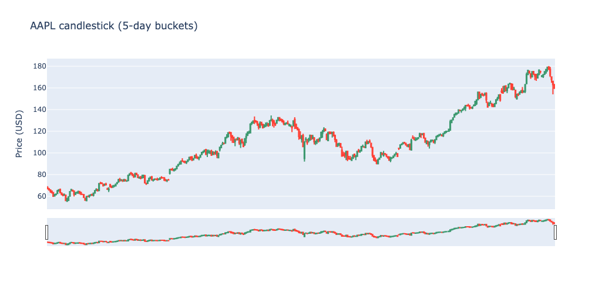
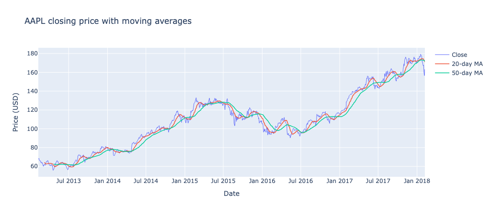

# Chapter 4: Temporal

## What Is It?

Relational databases handle time series as regular rows -- a price is just another record in a table, distinguished from other records by a date column. Neo4j handles time series as graph structure: each price is a node, connected to a stock node via a `HAS_PRICE` relationship. Temporal queries become traversal questions. Start at a stock node, follow its price nodes, filter by date, aggregate. The graph model makes the time dimension as queryable as any other structure in the graph.

Neo4j's native `date` and `datetime` types are first-class values in Cypher. A `date` property on a node is not stored as a string -- it has a structured representation that Cypher understands natively. You filter with `WHERE p.date >= date($start)`, sort chronologically and compute durations with `duration.between()`. A range index on `Price.date` supports date-range lookups on the price nodes. For queries that start from a single `Stock` node, as most of ours do, the planner may simply expand from the stock and filter, so check the plan with `PROFILE` if performance matters.

## When Would You Reach for It?

Temporal queries in Neo4j earn their place when time is one dimension of a richer graph rather than the only dimension. Pure time series problems -- high-frequency trading data, IoT sensor streams at millisecond resolution -- belong in purpose-built time series databases. But when your time-varying data are connected to other entities that carry meaning, Neo4j handles the combination naturally.

Reach for Neo4j's temporal capability when:

- Your time-varying data are connected to other nodes -- issuers, counterparties, events
- You want to combine date-range queries with graph traversal in a single operation
- You need date arithmetic -- durations, period comparisons -- as part of a graph query
- You're already using Neo4j and don't want to add a separate time series store

Financial data are a natural fit: prices are time series, but stocks are connected to each other through shared market behavior and the relationship between two stocks' price histories is itself a meaningful query.

## The Use Case

For this chapter we'll build a stock price analysis tool for a curated subset of S&P 500 companies. Users can view the full price history for any symbol, display it as a candlestick chart with configurable bucket sizes, overlay 20-day and 50-day moving averages, compare the performance of all symbols across the full five-year period and explore the price correlation between any two symbols in the notebook. The Streamlit app covers everything except the correlation.

## The Data

We use the [S&P 500 historical price dataset](https://www.kaggle.com/datasets/camnugent/sandp500) from Kaggle, published under CC0 license. The full dataset covers 505 symbols from February 2013 to February 2018. We pick a curated list of 150 symbols across major sectors -- Technology, Financials, Healthcare, Consumer and others. Three of them aren't present in the dataset, so we load 147, which keeps the total node count within Aura's free-tier limit of 200,000 nodes.

The graph model is:

```
(:Stock {symbol})-[:HAS_PRICE]->(:Price {date, open, high, low, close, volume})
```

`Stock` nodes carry only the `symbol` property. `Price` nodes carry the full OHLCV data for one trading day. At 147 symbols over roughly 1,260 trading days each, the graph contains 184,774 `Price` nodes. The model is deliberately simple -- a single `Stock` to `Price` star with no other entities -- so the chapter can focus on the temporal queries.

## Building the Application

### Prerequisites

You'll need a Neo4j Aura free-tier instance with the connection details stored as environment variables:

```shell
export NEO4J_URI="neo4j+s://xxxx.databases.neo4j.io"
export NEO4J_USERNAME="your-username"
export NEO4J_PASSWORD="your-password"
export NEO4J_DATABASE="your-database"
```

Download `all_stocks_5yr.csv` from the Kaggle dataset and place it in a `data` folder next to the notebook. Run the notebook first to load the graph, then start the app with `streamlit run app.py`. The notebook clears the database named in `NEO4J_DATABASE` before loading, so don't point it at a database you want to keep.

### Loading the Graph

We create a uniqueness constraint on `Stock.symbol` and a range index on `Price.date`, then load in two passes:

```python
session.run("""
    CREATE CONSTRAINT stock_symbol IF NOT EXISTS
    FOR (s:Stock) REQUIRE s.symbol IS UNIQUE
""")

session.run("""
    CREATE INDEX price_date IF NOT EXISTS
    FOR (p:Price) ON (p.date)
""")

# One Stock node per symbol
session.run("""
    UNWIND $symbols AS sym
    MERGE (:Stock {symbol: sym})
""", symbols=symbols)
```

Price nodes are loaded in batches of 1,000 rows using `UNWIND` to keep transaction size manageable:

```python
chunks = [records[i:i+CHUNK_SIZE] for i in range(0, len(records), CHUNK_SIZE)]

for chunk in tqdm(chunks, desc="Loading prices"):
    session.run("""
        UNWIND $rows AS row
        MATCH (s:Stock {symbol: row.symbol})
        CREATE (p:Price {
            date:   date(row.date),
            open:   row.open,
            high:   row.high,
            low:    row.low,
            close:  row.close,
            volume: row.volume
        })
        CREATE (s)-[:HAS_PRICE]->(p)
    """, rows=chunk)
```

We use `CREATE` rather than `MERGE` for price nodes -- each date is unique per stock and we're loading clean data, so `MERGE` would add overhead without benefit. Because `CREATE` isn't idempotent, re-running the load without clearing the database first would duplicate every price node. The notebook clears the database up front for that reason.

### Query 1: Price History

The price history query filters by date using Neo4j's native `date()` function:

```python
result = session.run("""
    MATCH (s:Stock {symbol: $symbol})-[:HAS_PRICE]->(p:Price)
    WHERE p.date >= date($start) AND p.date <= date($end)
    RETURN p.date  AS date,
           p.open  AS open,
           p.high  AS high,
           p.low   AS low,
           p.close AS close
    ORDER BY p.date
""", symbol=SYMBOL, start=START_DATE, end=END_DATE)
```

The Neo4j driver returns `date` values as its own `neo4j.time.Date` objects, not Python's `datetime.date`, and pandas can't convert them directly. To use them as a pandas datetime index for resampling, convert through strings with `pd.to_datetime(df["date"].astype(str))`.

### Query 2: Candlestick Chart

The daily OHLC data comes back from Neo4j as individual rows. We bucket it into windows of N calendar days in pandas using `resample()` and `agg()`:

```python
BUCKET_DAYS = 5

ohlc_df = (
    price_df
    .set_index("date")
    .resample(f"{BUCKET_DAYS}D")
    .agg(
        open=("open",  "first"),
        high=("high",  "max"),
        low=("low",   "min"),
        close=("close","last")
    )
    .dropna()
    .reset_index()
)
```

Each bucket takes the opening price of the first day, the closing price of the last day and the high and low across the entire window. Because the buckets are calendar days, a 5-day bucket holds at most five trading days, and often three or four. The `.dropna()` step removes empty buckets, which occur at small bucket sizes -- a 1-day bucket that falls on a weekend, for example.

Plotting with Plotly's `go.Candlestick` requires one formatting choice: set `type="category"` on the x-axis. Without it, Plotly treats the date axis as continuous and can leave gaps wherever a weekend or holiday removed a bucket, which is most visible at small bucket sizes. With `type="category"`, each bucket is an equal-width column regardless of the calendar gap:

```python
fig.update_xaxes(
    type="category",
    tickangle=-45,
    tickvals=ohlc_df["date"][::max(1, len(ohlc_df)//12)].astype(str).tolist()
)
```

Figure 4-1 shows an example using the AAPL symbol.



*Figure 4-1. AAPL Candlestick.*

### Query 3: Moving Averages

Moving averages are computed in pandas after retrieving the price series from Neo4j. Cypher has no built-in rolling window function, and `pandas.Series.rolling()` is the simpler tool for this purpose:

```python
price_df["ma_20"] = price_df["close"].rolling(window=20).mean()
price_df["ma_50"] = price_df["close"].rolling(window=50).mean()
```

The 20-day MA captures short-to-medium term trend; the 50-day MA shows the longer-term direction. Both averages need a full window of prices, so the first 19 and 49 days of a series have no value. The app computes them on the selected date range only, so the same gap appears at the start of whatever range you choose. We overlay both on the closing price as a three-line chart in Plotly.

Figure 4-2 shows an example using the AAPL symbol.



*Figure 4-2. AAPL Moving Averages.*

### Query 4: Best and Worst Performers

The performance query runs entirely in Cypher, using `min()` and `max()` on the date to anchor the first and last price nodes:

```python
result = session.run("""
    MATCH (s:Stock)-[:HAS_PRICE]->(p:Price)
    WITH s.symbol AS symbol,
         min(p.date) AS first_date,
         max(p.date) AS last_date
    MATCH (s:Stock {symbol: symbol})-[:HAS_PRICE]->(first:Price {date: first_date})
    MATCH (s)-[:HAS_PRICE]->(last:Price  {date: last_date})
    WITH symbol,
         first.close AS first_price,
         last.close  AS last_price,
         round((last.close - first.close) / first.close * 100, 2) AS pct_change
    RETURN symbol, first_price, last_price, pct_change
    ORDER BY pct_change DESC
""")
```

The query anchors on `min(p.date)` and `max(p.date)` rather than literal start and end dates because different symbols may have different first and last trading days in the dataset -- this approach handles a symbol that lists late or drops out early without any special casing. The results are displayed as a bar chart of the top 10 and bottom 10 performers, colored green for positive and red for negative returns.

### Query 5: Price Correlation

Do two stocks move together? We fetch the closing prices for both symbols on matching dates in a single Cypher query and compute the Pearson correlation in pandas:

```python
result = session.run("""
    MATCH (a:Stock {symbol: $sym_a})-[:HAS_PRICE]->(pa:Price)
    MATCH (b:Stock {symbol: $sym_b})-[:HAS_PRICE]->(pb:Price)
    WHERE pa.date = pb.date
    RETURN pa.date  AS date,
           pa.close AS price_a,
           pb.close AS price_b
    ORDER BY pa.date
""", sym_a=SYMBOL_A, sym_b=SYMBOL_B)

correlation = corr_df["price_a"].corr(corr_df["price_b"])
```

The `WHERE pa.date = pb.date` join happens in the graph query itself -- Neo4j matches price nodes from both stocks on the same date. We visualize the result as a dual-axis line chart, with each stock on its own y-axis so their price scales don't interfere.

One caution: correlating price levels mostly measures shared trend, since two rising series correlate strongly whatever their day-to-day behavior. For co-movement proper, correlate daily percentage returns instead.

### The Streamlit App

The application has three tabs. The Candlestick tab uses a symbol dropdown, a date range and a bucket size slider, all in the sidebar. It displays a summary of trading day count, first close and last close, then the candlestick chart. The Moving Average tab shows the same price series with 20-day and 50-day moving averages overlaid. The Performance tab shows the top 10 and bottom 10 performers across the full five-year period as a bar chart, with data tables for each group below.

The sidebar controls -- symbol, date range, bucket size -- apply to the Candlestick and Moving Average tabs. The Performance tab runs a separate cached query over all symbols and ignores the date range selection.

## What You'd Hit in Production

**Node count.** Aura's free tier caps at 200,000 nodes. 147 symbols at ~1,260 trading days each produces around 185,000 price nodes, which fits. The full 505-symbol dataset would produce around 619,000 price nodes and requires a paid tier. If you need more symbols, consider whether you need all five years of data or could work with a shorter window.

**Candlestick x-axis.** The `type="category"` setting on the x-axis matters for candlestick charts with date gaps. Without it, Plotly can render weekends and holidays as empty space, making the chart hard to read. This applies to any OHLC chart with non-continuous dates.

**Date conversion.** The Neo4j driver returns `date` values as `neo4j.time.Date` objects, which pandas can't convert directly. Pandas needs `datetime64` for `resample()` to work. Converting through strings with `pd.to_datetime(df["date"].astype(str))` is simple and reliable for ISO dates.

**Intra-day data.** The one-price-per-trading-day model doesn't extend to intra-day or tick data. Minute-level data for 147 stocks over five years would be around 72 million price nodes (390 one-minute bars per trading day) -- well beyond what Neo4j Aura's free tier can hold.

**Moving averages in Cypher.** Computing a rolling mean in pure Cypher is possible but verbose, and pandas is simpler. The division of labor in this chapter -- Neo4j for retrieval and filtering, pandas for numerical computation -- is the right default for this kind of analytical workload.

## Going Further

Prices and dates are structured, numeric data. Every property in chapters 1 through 4 has been a scalar: a name, a coordinate, a date, a number. Chapter 5 explores what happens when nodes need to carry richer, more complex payloads -- variable-structure metadata that differs across instances of the same node type. That requires a different approach to property storage and it's where we go next.
