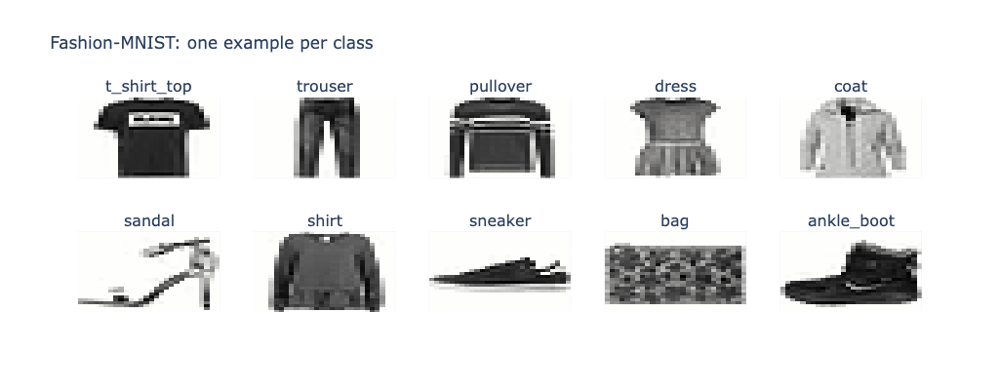
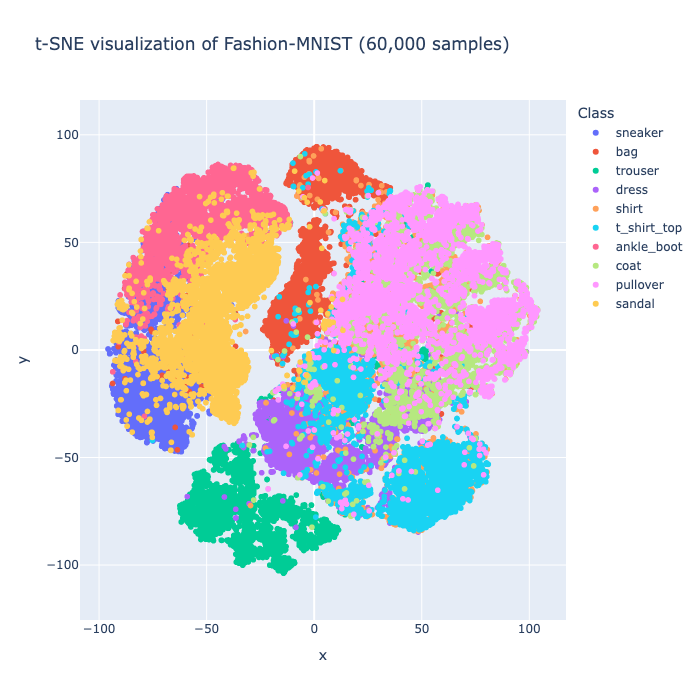

# Chapter 6: Vector search

## What is it?

A vector index stores high-dimensional numerical representations of data and answers a different kind of question from the ones we've asked so far. Not "find items where this field equals that value" but "find items that are most similar to this one." Similarity is measured by distance in vector space -- items whose vectors are close together are considered similar, regardless of whether they share any explicit property values.

Neo4j supports native vector indexes with approximate nearest neighbor (ANN) search, enabling fast similarity queries directly in Cypher. You create the index on a list property that holds the vector, call `db.index.vector.queryNodes()` to retrieve the k nearest neighbors and compose the result with any further Cypher -- graph traversal, property filters, aggregations -- in the same statement.

The key word is approximate. ANN search trades a small amount of recall for a large gain in speed. For most real-world similarity use cases -- find me items that look like this one, find documents semantically similar to this query -- approximate results are close enough to exact results to serve the purpose.

## When would you reach for it?

Vector search earns its place when similarity is the query rather than equality. Traditional indexes answer exact match and range queries. Vector indexes answer "nearest neighbors" queries, which is the right abstraction for image similarity, semantic text search, recommendation and anomaly detection.

Reach for Neo4j's vector search when:

- You want to find items similar to a given item, where "similar" means close in a learned or computed embedding space
- You're already using Neo4j and want to combine vector similarity with graph traversal in a single query
- You need to filter similarity results by graph structure -- "find the 5 most similar items that belong to this category"

The last point is where Neo4j's vector search stands out. A standalone vector database returns similar vectors, typically filtered on stored metadata. Neo4j can return similar vectors that also satisfy a graph pattern -- traversing relationships to filter or enrich the results. That combination is what we demonstrate in this chapter and it's what chapter 7 builds on directly.

## The use case

For this chapter we'll build a clothing image similarity explorer using the Zalando Fashion-MNIST dataset -- 70,000 labeled grayscale images across 10 clothing categories, released under the MIT License. We store each image as a 784-element vector (the flattened, normalized pixel values) alongside a graph that connects each item to its category. Users can pick a random item from any category, run a k-nearest-neighbor search against the full 70,000-item index and see which images are most visually similar.

## The data

Fashion-MNIST contains 60,000 training images and 10,000 test images across 10 clothing categories: t-shirt/top, trouser, pullover, dress, coat, sandal, shirt, sneaker, bag and ankle boot. Each image is 28x28 pixels in grayscale.

The vector representation is straightforward -- no embedding model required. We normalize pixel values to [0,1] and flatten each 28x28 image into a 784-element float vector. This is a deliberate choice: pixel vectors are interpretable, require no external model and are sufficient to demonstrate the mechanics of vector search and graph-filtered similarity.

The graph model is:

```
(:Item {uid, id, label, split, vector})-[:BELONGS_TO]->(:Category {name})
```

`id` is the zero-based index within the split (0-59999 for train, 0-9999 for test). `split` is `"train"` or `"test"`. `uid` is a globally unique string combining both -- `"train_0"`, `"test_500"` -- and is the uniqueness key. Two items can share the same `id` if they're in different splits. `vector` holds the 784-element list property that the vector index is built on.

Figure 6-1 shows one example from each of the ten clothing categories.



*Figure 6-1. Fashion-MNIST Examples.*

## Building the application

### Prerequisites

You'll need a Neo4j Aura free-tier instance with the connection details stored as environment variables:

```shell
export NEO4J_URI="neo4j+s://xxxx.databases.neo4j.io"
export NEO4J_USERNAME="your-username"
export NEO4J_PASSWORD="your-password"
export NEO4J_DATABASE="your-database"
```

Fashion-MNIST is fetched automatically via scikit-learn's `fetch_openml`. The first run downloads the dataset, so you'll need an internet connection. Run the notebook first to load the graph, then start the app with `streamlit run app.py`. The notebook clears the database named in `NEO4J_DATABASE` before loading, so don't point it at a database you want to keep.

### Loading the data

We fetch Fashion-MNIST via scikit-learn, normalize and flatten the images, then build two DataFrames:

```python
fashion = fetch_openml(name="Fashion-MNIST", version=1, as_frame=False)
X, y = fashion.data, fashion.target.astype(np.uint8)

train_images_raw = X[:60000].reshape(-1, 28, 28)
test_images_raw  = X[60000:].reshape(-1, 28, 28)
train_labels     = y[:60000]
test_labels      = y[60000:]

# Normalize to [0, 1] and flatten to 784-element vectors
train_images = (train_images_raw.astype("float32") / 255.0).reshape(-1, 784)
test_images  = (test_images_raw.astype("float32")  / 255.0).reshape(-1, 784)

train_df = pd.DataFrame({
    "id":     np.arange(len(train_images)),
    "vector": list(train_images),
    "label":  [CLASSES[l] for l in train_labels],
    "split":  "train"
})
```

### Loading the graph

We clear the database, create uniqueness constraints, load `Category` nodes for the 10 classes, then load `Item` nodes in batches of 500:

```python
session.run("""
    CREATE CONSTRAINT category_name IF NOT EXISTS
    FOR (c:Category) REQUIRE c.name IS UNIQUE
""")
session.run("""
    CREATE CONSTRAINT item_uid IF NOT EXISTS
    FOR (i:Item) REQUIRE i.uid IS UNIQUE
""")

session.run("""
    UNWIND $names AS name
    MERGE (:Category {name: name})
""", names=CLASSES)
```

The uniqueness constraint is on `uid`, not `id`. If the constraint were on `id`, items from different splits with the same integer would conflict. The `uid` field -- `"train_0"`, `"test_500"` -- is unique across the entire graph.

Items are loaded in chunks of 500 using `UNWIND`. Each item is linked to its category via `BELONGS_TO`:

```python
session.run("""
    UNWIND $rows AS row
    CREATE (i:Item {
        uid:    row.uid,
        id:     row.id,
        label:  row.label,
        split:  row.split,
        vector: row.vector
    })
    WITH i, row
    MATCH (c:Category {name: row.label})
    CREATE (i)-[:BELONGS_TO]->(c)
""", rows=chunk)
```

With 70,000 items batched at 500, this is 140 transactions. Expect the full load to take several minutes on Aura's free tier.

### Creating the vector index

A single Cypher call creates the vector index using Euclidean distance:

```python
session.run("""
    CREATE VECTOR INDEX item_vector IF NOT EXISTS
    FOR (i:Item) ON (i.vector)
    OPTIONS {indexConfig: {
        `vector.dimensions`: 784,
        `vector.similarity_function`: 'euclidean'
    }}
""")
```

Euclidean distance is appropriate for pixel vectors -- it measures how far apart two images are pixel by pixel, as the square root of the summed squared differences across all 784 pixels. The index turns that distance into a score of 1 / (1 + squared distance), so identical vectors score 1 and the score falls toward 0 as the images differ. For semantic text embeddings, cosine similarity is usually the better choice.

### t-SNE visualization

Before querying the index, we use t-SNE to project the 784-dimensional vectors into 2D and verify that the categories form distinct clusters. We run t-SNE with the Barnes-Hut algorithm on all 60,000 training items, shuffled with a random permutation:

```python
rng = np.random.default_rng(42)
idx = rng.choice(len(train_images), 60000, replace=False)
X_sample = train_images[idx]

tsne = TSNE(
    n_components=2,
    random_state=42,
    method="barnes_hut",
    perplexity=30,
    max_iter=1000
)
X_tsne = tsne.fit_transform(X_sample)
```

The resulting scatter plot, colored by class, shows clear clusters for most categories -- trousers and bags are well separated; t-shirts, shirts and pullovers cluster more closely, which matches the visual similarity of those garments. This suggests the pixel vectors carry real class structure, which is what we need for the nearest neighbors to be meaningful. On our run, t-SNE took about two minutes.

Figure 6-2 shows the projection.



*Figure 6-2. t-SNE Projection.*

### Query 1: k-NN within the training set

The standard k-NN query fetches the query vector from Neo4j, then calls the vector index:

```python
# Fetch the query vector
q = session.run("""
    MATCH (i:Item {id: $id, split: $split})
    RETURN i.vector AS vector, i.label AS label
""", id=QUERY_ID, split="train").single()

# k-NN search
result = session.run("""
    CALL db.index.vector.queryNodes('item_vector', $k, $vector)
    YIELD node AS i, score
    WHERE i.split = $split
    RETURN i.id AS id, i.label AS label, i.split AS split, score
    ORDER BY score DESC
""", k=K * 3, vector=q["vector"], split="train")
```

Three things to note. First, the score is a similarity, not a distance -- a higher score means greater similarity (closer in vector space). Second, the query item itself always appears first with a perfect score of 1.0. The notebook keeps it as the first row, while the app excludes it. Third, the `WHERE` clause runs after the index returns its `k * 3` candidates, so it's a post-filter and can leave fewer than `k` rows.

The image grid renders the query item and its nearest neighbors using Plotly's `go.Heatmap` with `colorscale="gray_r"` -- inverted grayscale gives white backgrounds with dark clothing outlines, which reads more naturally than the raw dark-background representation.

### Query 2: k-NN within the test set

The same pattern applied to a test-split query item. Because train and test items are in the same index, we filter by `i.split = 'test'` in the `WHERE` clause. Test items are only one-seventh of the index, so few of the 15 candidates survive the filter: in our run the query returned just one neighbor besides the query item itself. Fetching a larger multiple of `k` would fix that.

### Query 3: Cross-set similarity search

A train item queries against the test set, or vice versa. This tests whether the vector representations generalize across splits -- whether a training image of a dress finds similar test images of dresses:

```python
result = session.run("""
    CALL db.index.vector.queryNodes('item_vector', $k, $vector)
    YIELD node AS i, score
    WHERE i.split = 'test'
    RETURN i.id AS id, i.label AS label, i.split AS split, score
    ORDER BY score DESC
""", k=K * 3, vector=query_vector)
```

In our run the post-filter left a single test-set neighbor and it's a dress like the query, which suggests the pixel vectors carry across the train/test split. Because test items are so few in the index, a larger candidate count is needed to see more than one or two of them.

### Query 4: Graph-filtered k-NN

This is where the graph model adds value. We keep only items in a specific category by traversing the `BELONGS_TO` relationship after the vector index call:

```python
result = session.run("""
    CALL db.index.vector.queryNodes('item_vector', $k, $vector)
    YIELD node AS i, score
    MATCH (i)-[:BELONGS_TO]->(c:Category {name: $category})
    RETURN i.id AS id, i.label AS label, i.split AS split, score
    ORDER BY score DESC
""", k=K * 10, vector=query_vector, category="dress")
```

We fetch `k * 10` candidates so that enough remain after the category filter. This is a post-filter pattern -- the vector index searches all 70,000 items and finds the approximate nearest neighbors globally, then the graph traversal filters to the target category. Here the target is the query's own category, so most of the candidates survive and 10x is plenty. A category unlike the query could leave few or no rows and a larger multiplier wouldn't always rescue it.

This pattern -- vector search then graph filter -- is the foundation of what chapter 7 builds into a full fraud detection system.

### The Streamlit app

The app has a sidebar with controls for the query category, query split, results split filter, results category filter and k. A "Pick random item and search" button selects a random item from the chosen category and split, fetches its vector from Neo4j and runs the k-NN search.

The main area shows a summary of the query item and result count, an image grid of the query item and its nearest neighbors rendered as Plotly heatmaps, a category breakdown bar chart showing which categories appear in the results and a collapsible table of the full results. The image grid renders both the query image and result images from the in-memory Fashion-MNIST arrays rather than fetching pixel data from Neo4j, which saves a round trip per image. The app drops the query item from its own results and fetches `k * 10` candidates to leave room for the filters.

Results persist in `st.session_state` across re-runs so the display doesn't disappear when sidebar controls are adjusted.

## What you'd hit in production

**ANN vs exact search.** Neo4j's vector index uses approximate nearest neighbor search. For the Fashion-MNIST use case the approximation is good enough that the neighbors look right, though we haven't measured recall. For use cases where recall must be guaranteed (medical imaging, legal document retrieval), exact search may be required, which is slower but available.

**Index creation time.** Creating the vector index over 70,000 items with 784 dimensions can take a few minutes on Aura's free tier. The index creation is asynchronous -- check the index state before querying, as the notebook does with a short polling cell.

**Post-filter overhead.** The graph-filtered k-NN query (Query 4) fetches `k * 10` candidates to ensure enough survive the category filter. If the target category is rare in the index, you may need a larger multiplier. An alternative is pre-filtering, which restricts the search inside the index. `db.index.vector.queryNodes()` doesn't offer it, but newer versions of Neo4j add a `SEARCH` clause that can filter on node properties inside the index search. It accepts property predicates only, so a graph pattern such as `BELONGS_TO` remains a post-filter. Check the documentation for your version.

**Vector storage.** A plain `CREATE` or `SET` stores a list of floats as 64-bit doubles, so each 784-element vector takes about 6KB. 70,000 vectors come to around 440MB, before counting the vector index itself. Storing the vectors with `db.create.setNodeVectorProperty()` uses 32-bit floats and roughly halves that. Check the total against your instance's storage limit. For higher-dimensional vectors -- 384-element sentence embeddings, 1536-element OpenAI embeddings -- storage requirements grow accordingly.

**The `split` filter.** The `WHERE i.split = $split` clause in queries 1 to 3 runs after the ANN index returns candidates. It's a post-filter, not a pre-filter. Our split is unbalanced -- test items are one-seventh of the index -- and with `k * 3` candidates queries 2 and 3 returned only one neighbor each. For unbalanced splits, fetch many more candidates than you need.

## Going further

Vector search finds similar items by distance in vector space. Graph traversal finds connected items by relationship. In this chapter we combined them: a vector search followed by a graph filter in a single Cypher statement. That combination is powerful, but both steps still ran independently -- the vector search found candidates globally, then the graph reduced them.

Chapter 7 tightens the integration. We use vector search to find semantically suspicious transactions, then use graph traversal to confirm whether those transactions form a circular money flow -- a fraud ring. The vector component identifies candidates the graph component couldn't find alone; the graph component validates structure the vector component can't see. That's the full combination and it's where this book ends up.
