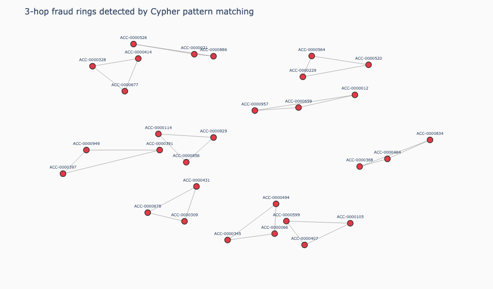

# Chapter 7: Graph + Vector

## What is it?

Vector search answers "which transactions look suspicious?" Graph traversal answers "which accounts are connected through circular money flows?" Used together, they answer a third question that neither can answer alone: "which suspicious-looking transactions are part of a coordinated fraud ring?"

This is the combination the book has been building toward. Every capability in the preceding chapters -- graph traversal, full-text search, geospatial queries, temporal reasoning, document properties, vector search -- was a standalone tool. Chapter 7 brings two of the most powerful together in a single Cypher query: a vector similarity search that identifies semantically suspicious transactions, followed immediately by a graph traversal that checks whether each of those transactions is part of a circular ring.

The result is a fraud detection system with three operational modes. Pure graph ring detection finds coordinated circular money flows using Cypher pattern matching. Pure vector search finds transactions whose prose descriptions resemble known fraud language. Graph + vector combined does both in a single query, surfacing only those suspicious transactions that also participate in a ring -- a stronger fraud signal than either approach alone.

## When would you reach for it?

The graph + vector combination earns its place when your fraud signal has two components: semantic content (what a transaction is described as) and structural position (who sent it and to whom and how those accounts are connected). Either component alone produces noise. Together they produce signal.

Reach for this pattern when:

- You have text or embeddings that can identify suspicious entities
- You have a graph that can validate whether those entities are structurally connected in a suspicious pattern
- You need to run both in a single query rather than two separate systems
- The false positive rate from either approach alone is too high for the use case

Financial fraud is the canonical application, but the same pattern applies to social network abuse detection, supply chain anomaly detection and any domain where suspicious behavior has both a semantic signature and a structural pattern.

## The use case

We build a synthetic fraud detection system with 1,000 bank accounts and approximately 50,000 transactions. The vast majority of transactions are legitimate -- ring transactions account for less than 0.3% of the data. Hidden in the transaction graph are planted fraud rings of 3, 4 and 5 hops, plus random rings of up to 6 hops. Every ring amount falls between $2,000 and $9,999, the amounts within one ring differ by at most 3% and each ring completes in under 90 minutes.

The challenge is finding those rings without knowing in advance which accounts or transactions are involved.

## The data

The dataset is generated entirely in the notebook with a fixed random seed for reproducibility.

**Accounts**: 1,000 nodes with `account_id`, `customer_name` and `risk_score` properties. About 20% of account names are business names (LLC, Inc, Corp); the rest are personal names.

**Transactions**: ~50,000 total. Each has `tx_id`, `amount`, `timestamp`, `is_fraud_ring` (the hidden ground truth), `description` (a prose sentence) and `embedding` (a 384-element fastembed vector).

**Fraud rings**: planted in three sizes -- five 3-hop rings (min amount $4,000), five 4-hop rings (min amount $3,500) and three 5-hop rings (min amount $3,000). Twenty additional rings with random sizes of 3 to 6 hops and random amounts add background complexity. They're generated the same way and carry the same fraud flag, so any 6-hop rings among them are ones that none of our detection queries search for. In all, the rings account for 134 transactions. Within a ring the amounts differ by at most 3%, and the transaction at hop number `i` is stamped `i` x 3-15 minutes after the ring starts (a fresh random draw per hop), so a ring completes within 75 minutes.

**Transaction descriptions**: ring transactions use templates that sound like structuring or layering: "Structured transfer of $X through intermediary account -- round-trip pattern." Legitimate transactions describe plausible purchases at fictional merchants. The ring descriptions come from five fixed templates and the legitimate ones from four, so the two groups separate easily in embedding space. That's by design, not something to expect from real data.

The graph model is:

```
(:Account {account_id, customer_name, risk_score})
  -[:MADE]->
(:Transaction {tx_id, amount, timestamp, is_fraud_ring, description, embedding})
  -[:TO]->
(:Account)
```

## Building the application

### Prerequisites

You'll need a Neo4j Aura free-tier instance with the connection details stored as environment variables:

```shell
export NEO4J_URI="neo4j+s://xxxx.databases.neo4j.io"
export NEO4J_USERNAME="your-username"
export NEO4J_PASSWORD="your-password"
export NEO4J_DATABASE="your-database"
```

This chapter uses `fastembed` for embedding the transaction descriptions. `fastembed` downloads the `BAAI/bge-small-en-v1.5` model (~67 MB) on first use and caches it locally. The model produces 384-dimensional embeddings and runs entirely locally -- no API key required.

The notebook generates all the data itself. Run it first to load the graph, then start the app with `streamlit run app.py`. The notebook clears the database named in `NEO4J_DATABASE` before loading, so don't point it at a database you want to keep.

### Loading the embedding model

```python
from fastembed import TextEmbedding

embed_model = TextEmbedding("BAAI/bge-small-en-v1.5")

def get_embedding(text: str) -> list:
    return list(embed_model.embed([text]))[0].tolist()

EMBEDDING_DIMS = len(get_embedding("test"))  # 384
```

We call `embed_model.embed([text])` with a list and take the first result. This is slightly less efficient than batch embedding but keeps the helper function simple. For the full 50,000 transactions we embed in batches.

### Loading the graph

We load accounts first, then embed and load transactions in batches of 500. The embedding step dominates the load time for 50,000 transactions and how long it takes depends on your hardware:

```python
def embed_and_load_batch(session, batch):
    texts  = [r["description"] for r in batch]
    embeds = list(embed_model.embed(texts))
    rows   = [
        {**rec, "embedding": embeds[i].tolist()}
        for i, rec in enumerate(batch)
    ]
    session.run("""
        UNWIND $rows AS row
        MATCH (src:Account {account_id: row.source_id})
        MATCH (tgt:Account {account_id: row.target_id})
        CREATE (t:Transaction {
            tx_id:         row.tx_id,
            amount:        row.amount,
            timestamp:     row.timestamp,
            is_fraud_ring: row.is_fraud_ring,
            description:   row.description,
            embedding:     row.embedding
        })
        CREATE (src)-[:MADE]->(t)
        CREATE (t)-[:TO]->(tgt)
    """, rows=rows)
```

Each transaction is connected to two accounts: the source account via `MADE` and the target account via `TO`. This two-relationship pattern is what enables Cypher to traverse ring patterns using comma-separated patterns in a single `MATCH`.

### Creating the vector index

The vector index uses cosine similarity, which is appropriate for sentence embeddings:

```python
session.run(f"""
    CREATE VECTOR INDEX transaction_embeddings
    FOR (t:Transaction) ON (t.embedding)
    OPTIONS {{indexConfig: {{
        `vector.dimensions`: {EMBEDDING_DIMS},
        `vector.similarity_function`: 'cosine'
    }}}}
""")
```

We poll until the index is `ONLINE` before running any similarity queries -- index creation is asynchronous.

### Query 1: Pure graph ring detection

Cypher expresses a 3-hop ring as a comma-separated pattern that returns to its origin:

```python
result = session.run("""
    MATCH (a1:Account)-[:MADE]->(t1:Transaction)-[:TO]->(a2:Account),
          (a2)-[:MADE]->(t2:Transaction)-[:TO]->(a3:Account),
          (a3)-[:MADE]->(t3:Transaction)-[:TO]->(a1)
    WHERE t1.amount >= $min_amount AND t1.amount <= $max_amount
      AND t2.amount >= $min_amount AND t2.amount <= $max_amount
      AND t3.amount >= $min_amount AND t3.amount <= $max_amount
      AND a1.account_id < a2.account_id
      AND a1.account_id < a3.account_id
      AND abs(datetime(t1.timestamp).epochSeconds
              - datetime(t2.timestamp).epochSeconds) < 5400
      AND abs(datetime(t2.timestamp).epochSeconds
              - datetime(t3.timestamp).epochSeconds) < 5400
    RETURN a1.account_id AS account_1,
           a2.account_id AS account_2,
           a3.account_id AS account_3,
           t1.amount AS amount_1,
           t2.amount AS amount_2,
           t3.amount AS amount_3
    LIMIT $limit
""", min_amount=min_amount, max_amount=max_amount, limit=limit)
```

The default `limit` is 10, so the notebook lists at most ten rings even when more exist. The confirmation query in the notebook counts 12 planted 3-hop rings above $3,000, so the list shows ten of the twelve.

Three filters work together to eliminate coincidental rings:

**Amount range** (`min_amount` to `max_amount=9999`): legitimate transactions go up to $50,000. Ring transactions are generated between $2,000 and $9,999. The upper bound eliminates the vast majority of coincidental cycles formed by legitimate high-value transactions.

**Timestamp constraint** (within 90 minutes): we compare the epoch seconds of consecutive transactions, so the check measures real elapsed time. We avoid `duration.between(...).minutes` because it ignores whole days and months, which would let two transactions days apart pass. Ring hops are stamped within 75 minutes of the ring start and no two consecutive hops are more than 63 minutes apart, so a 90-minute window catches every planted ring while eliminating coincidental cycles between transactions days apart.

**Deduplication** (`a1.account_id < a2.account_id AND a1.account_id < a3.account_id`): without this, every ring appears multiple times -- once for each starting account. The ordering constraint (account IDs compare as strings) keeps only the rotation that starts at the lowest account ID, so each ring is returned once.

One Cypher detail: the patterns inside a single `MATCH` are separated by commas. Writing them one after another without a comma is a syntax error.

The same structure extends naturally for 4-hop and 5-hop rings by adding one more account and transaction to the pattern. In SQL you'd add one more self-join per hop, or write a recursive CTE with a depth cap and path tracking and both get harder to read and tune as the rings grow.

### Query 2: Pure vector search

Pure vector search embeds the query string and finds semantically similar transactions:

```python
query_embedding = get_embedding("circular money transfer through intermediary accounts")

result = session.run("""
    CALL db.index.vector.queryNodes(
        'transaction_embeddings', $top_k, $embedding
    ) YIELD node AS t, score
    MATCH (src:Account)-[:MADE]->(t)-[:TO]->(tgt:Account)
    RETURN t.tx_id         AS tx_id,
           src.account_id  AS source_account,
           tgt.account_id  AS target_account,
           t.amount        AS amount,
           t.is_fraud_ring AS is_fraud_ring,
           t.description   AS description,
           score
    ORDER BY score DESC
""", embedding=query_embedding, top_k=top_k)
```

The vector search returns transactions whose descriptions are semantically similar to the query. Because ring transactions were generated with structuring and layering language, the queries we ran about circular money movement returned only ring transactions in their top five, with similarity scores above 0.90. The index reports cosine similarity as (1 + cosine) / 2, so scores run from 0 to 1. But pure vector search has no awareness of whether those transactions form rings -- it can flag individual suspicious transactions without confirming the pattern.

### Query 3: Graph + vector combined

The combined query runs vector search first, then immediately extends into graph traversal in the same Cypher statement. The suspicious transaction must itself be the first hop of a ring: it leaves its source account and the receiving account's onward transfers lead back to the source:

```python
result = session.run(f"""
    // Step 1: vector search finds semantically suspicious transactions
    CALL db.index.vector.queryNodes(
        'transaction_embeddings', $top_k, $embedding
    ) YIELD node AS t, score
    WHERE score >= $threshold

    // Step 2: check whether the transaction is the first hop of a ring
    {ring_match}
    WHERE {ring_where}

    RETURN DISTINCT
        t.tx_id         AS tx_id,
        score           AS similarity,
        a1.account_id   AS source_account,
        t.amount        AS amount,
        t.is_fraud_ring AS is_fraud_ring,
        {ring_return}
    ORDER BY score DESC
""", embedding=query_embedding, top_k=top_k, threshold=threshold,
     min_amount=min_amount, max_amount=max_amount)
```

The `ring_match` and `ring_where` strings are built dynamically based on the `ring_hops` parameter (3 or 4). For a 3-hop ring check, `ring_match` starts at the source account of the suspicious transaction, follows it to its receiving account and then through two more `MADE`/`TO` hops back to the source; `ring_where` applies the amount and timestamp filters to every transaction in the ring, including the suspicious one; `ring_return` returns the list of ring account IDs.

This is the key result: only transactions that are both semantically suspicious (high similarity to the query) and structurally connected (the first hop of a circular ring) appear in the output. Because the ring is anchored on the suspicious transaction, each ring transaction that scores well appears as its own row. The `is_fraud_ring` flag confirms against the hidden ground truth.

### Ring summary

A batch ring summary query counts the detected 3-hop rings and confirmed fraud:

```python
result = session.run("""
    MATCH (a1:Account)-[:MADE]->(t1:Transaction)-[:TO]->(a2:Account),
          (a2)-[:MADE]->(t2:Transaction)-[:TO]->(a3:Account),
          (a3)-[:MADE]->(t3:Transaction)-[:TO]->(a1)
    WHERE t1.amount >= 2000 AND t1.amount <= 9999
      AND t2.amount >= 2000 AND t2.amount <= 9999
      AND t3.amount >= 2000 AND t3.amount <= 9999
      AND a1.account_id < a2.account_id
      AND a1.account_id < a3.account_id
      AND abs(datetime(t1.timestamp).epochSeconds
              - datetime(t2.timestamp).epochSeconds) < 5400
      AND abs(datetime(t2.timestamp).epochSeconds
              - datetime(t3.timestamp).epochSeconds) < 5400
    RETURN count(*) AS ring_count,
           round(avg(t1.amount + t2.amount + t3.amount), 2) AS avg_total_amount,
           sum(CASE WHEN t1.is_fraud_ring = true THEN 1 ELSE 0 END) AS confirmed_fraud
""")
```

With the amount range and timestamp filters applied, this query returns 13 detected 3-hop rings, all 13 confirmed as planted fraud. That 100% precision comes with the territory on synthetic data: every ring is flagged as fraud and in this dataset the filters leave no legitimate cycles. The ring summary is a full graph scan and is slow enough that it's better as a batch analytical query than an interactive one.

### Ring visualization

Detected rings are visualized as a NetworkX force-directed graph rendered with Plotly. Red nodes (`#E63946`) represent accounts; grey edges show the direction of money flow. The spring layout with `k=1.0` spreads the nodes organically without forcing rigid geometric shapes:

```python
G = nx.DiGraph()
for r in ring_records:
    ring_nodes = [r[f"account_{i}"] for i in range(1, hops + 1)]
    for i, node in enumerate(ring_nodes):
        G.add_node(node)
        G.add_edge(node, ring_nodes[(i + 1) % hops], amount=r[f"amount_{i+1}"])

pos = nx.spring_layout(G, seed=RANDOM_SEED, k=1.0, iterations=100)
```

Figure 7-1 shows ten of the detected 3-hop rings -- each cluster of three nodes forms a circular money flow.



*Figure 7-1. 3-hop Fraud Rings.*

### The Streamlit app

The sidebar has a query type selector -- Pure Graph, Pure Vector, Graph + Vector -- with parameters that adapt to the selection. Pure Graph exposes hop count (3, 4 or 5), min/max amount and a result limit. Pure Vector exposes a query text area, vector candidate count and similarity threshold. Graph + Vector exposes the query text area, vector candidate count, similarity threshold, min/max amount and a ring depth of 3 or 4.

The app has two tabs. The Query Explorer tab runs the selected query and displays results as a dataframe -- ring paths and amounts for pure graph, transaction details and fraud flags for pure vector and the matching transaction plus its ring for graph + vector. The Ring Visualization tab is active after a Pure Graph query and renders the spring-layout ring graph.

All results persist in `st.session_state` across re-runs. The embedding model is cached with `@st.cache_resource` so it loads once and stays in memory for the session -- fastembed downloads are slow on first run but instant on subsequent ones.

## What you'd hit in production

**Embedding throughput.** fastembed with `BAAI/bge-small-en-v1.5` runs on CPU, so embedding time grows linearly with the number of transactions -- time the load on your own machine before scaling it up. For millions of transactions at ingestion time, batch embedding with a GPU or a hosted embedding API would be significantly faster.

**The `query` parameter conflict.** The Neo4j Python driver reserves `query` as a keyword argument for the Cypher string itself. Never use `query` as a parameter name in your Cypher parameters. Use `search_query`, `embedding`, `q` or any other name. This applies everywhere in the codebase, not just chapter 7.

**Ring summary performance.** The ring summary query scans the full transaction graph. Its cost grows with the number of transactions and the hop count. For production workloads you'd run this as a scheduled batch job rather than on demand and consider creating additional indexes to speed up the traversal.

**The `max_amount` filter.** Legitimate transactions go up to $50,000, so without the upper-bound filter (`amount <= 9999`) the pattern matches far more coincidental cycles and the time filter then has to reject each one. The ceiling removes most of them early. It isn't an arbitrary threshold -- it's grounded in the dataset design. In a real system you'd tune this threshold empirically based on the known amount distribution of your fraud cases.

**Timestamp storage.** Timestamps are stored here as ISO strings and parsed with `datetime()` inside every query. Storing them as native `datetime` values, as chapter 4 does for dates, avoids the repeated parsing and makes time arithmetic and indexing simpler.

## Going further

This chapter closes the arc the book has been tracing. We started with the graph model in chapter 1 -- stations, connections, traversal. We added capability by capability: text search, spatial queries, temporal data, document properties, vector similarity. Chapter 7 combines the last two into something that neither a graph query nor a vector query does alone.

The fraud detection system in this chapter is a demonstration, not a production deployment. A real system would need continuous ingestion, a real-time embedding pipeline, alerting thresholds calibrated against labeled historical data and human review of flagged cases. But the core pattern -- vector search to identify candidates, graph traversal to validate structure -- is a sound architecture for this class of problem and Neo4j is a natural database to run it on.

That's Neo4j beyond the graph.
